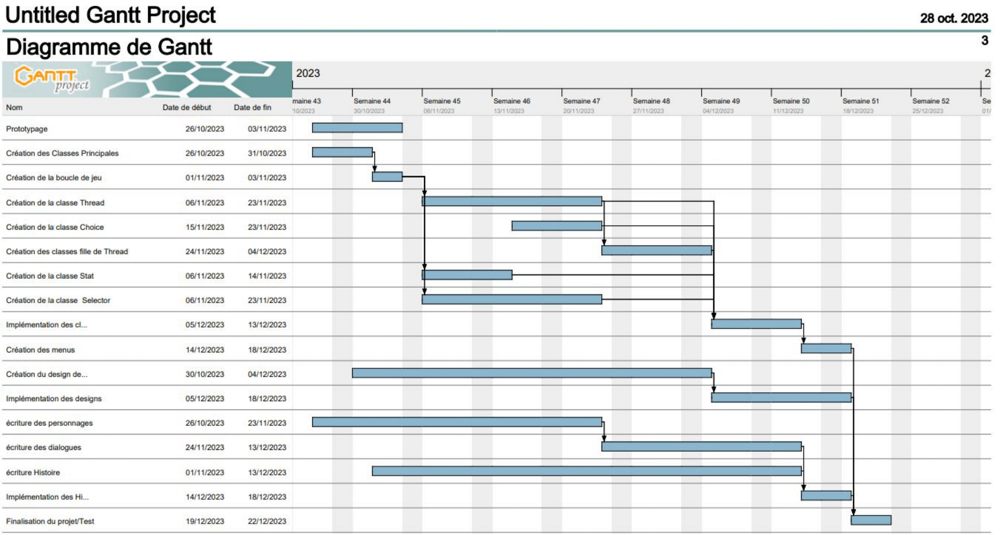

# CPO 02 Groupe2

## Reignib 
Reignib est un projet orienté objet en python basé sur le choix

### Présentation
Reignib est un jeu de choix inspiré du jeu [**Reign**](https://www.devolverdigital.com/games/reigns) par le développeur [_Nerial_](https://www.nerial.co.uk/).
La contrainte du développement durable, demandé par l'équipe pédagogique, est intégré dans le jeu en plaçant le joueur façe à des choix qui modifient la course de son royaume/état fictif. Une décision qui suit (implicitement) le développement durable aura des effets à long terme plus bénéfique et ouvrira la porte à plus de choix. Au contraire, un choix plutôt court-termiste, effectué pour relancer une partie, aura tendance à couper court à beaucoup d'initiatives et donc à réduire les choix et leurs portées sur le jeu.

### 4 étudiants contribuent au projet:
- MADEC Maël (m0madec@enib.fr)
- COLLET Guillaume (g0collet@enib.fr)
- LE CORFF Louis (l0lecorf@enib.fr)
- LAGADIC Youenn (y0lagadi@enib.fr)

## Réalisation

### Dossier de conception
Le [dossier de conception](https://git.enib.fr/y0lagadi/CPO_02_Groupe2/-/blob/main/UML/REIGNIB_presentation.pdf?ref_type=heads) a été réalisé à l'aide de diagrams.net et présente le projet sous l'aspect conception en UML demandée en P1. 

### Roadmap 

### Tâches
Les tâches associées au diagramme de Gantt sont présentes et éditées dans le panel [Issues](https://git.enib.fr/y0lagadi/CPO_02_Groupe2/-/issues) et [Issue board](https://git.enib.fr/y0lagadi/CPO_02_Groupe2/-/boards).

### Déroulé du projet en dates

**7/11/2023 :** 
- Création du repository, du readme.md et des tâches
- Ajout des fichiers effectués pendant les vacances
- Ajout du dossier de conception UML dans le dossier 'UML'

**Du 7 au 14 :**
- Fusion des classes Thread et Selector
- Creation de cardlib.py, cfg.py, tools.py, display_events.py pour aider a la structuration du programme
- Modification du main : deplacement du code spaghetti fonctionnel vers les modules dediés pour le clarté
- .gitignore
- Modification selector et thread pour matcher la nouvelle structure, pas de modifications significatives

**14/11/2023 :**
- Début de la rédaction ludique (personnages, suite de cartes, idées de choix, ect...)
- Début du développement du framework de données (csv de cartes, gestions des cartes, images et son)
- Début du développement d'un outil d'édition de cartes spécialisé (creation_cartes.ipynb)
- Création des menus (classes) et rajout dans la mouture
- Création classe mère Menu
- Création classe MainMenu composé de trois bouton (Jouer, Paramètres, Quitter)
- Création classe SettingsMenu composé d'un bouton (Retour)
- Création classe TransitionMenu composé d'une barre de chargement (Menu faisant la transition entre MainMenu et le jeu)

**Du 14 au 21 :**
- Outil de création des cartes fini
- Système de stockage des cartes fini
- Prise en charge des menus mis en place
- Création du menu principal, du menu des Paramètres
- Création d'une transition entre le jeu en lui-même et le menu principal

**21/11/23:**
- Debut du layout du jeu
- Choix des éléments graphiques
- Rangement du projet
- Debut du système sonore (branche son)
- Branche gamefeel pour le plaisir de jeu

**Du 21/11 au 28/11:**
- Implémentation du layout de test complet
- Génération des images pour le background, réajustement du style graphique
- Indications choix marqués
- Logos, animations des stats
- Interface de jeu 

**28/11/23:**
- Toggle fullscreen
- fix #3 de creation cartes
- Implémentation de sons et de leur gestion
- Menu de pause (et l'ESC override)
- Ajouts de plusieurs boutons UI/UX
- Ajouts des textes d'arrières de cartes
- Sliders de son

**Du 28/11 au 05/12:**
- Merging de toutes les branches vers main pour passer a un trunk-based dev.
- Révision de thread vers un modèle d'arbre binaire
- Implémentation de la gestion du volume
- Implémentation d'une soixantaine de cartes 
- Fix des icônes

**05/12/23:**
- Grande série de bugfixes pour la jouabilité
- Ajouts d'animations pour signifier les changements
- Plusieurs réajustements et upscales pour les images
- Affichage des modifications
- Images d'arrières de cartes

**Du 05 au 12/12:**
- Optimisation du chargement initial (de ~20s à ~6s)
- Rationalisation de nombreuses images (depuis le pool commun)
- Optimisation de la performance de la boucle de jeu :
        - Lagspike initial de ~2s à ~0.5s 
        - Lag à l'affichage d'une nouvelle carte grandement réduit
        - Absence de décalage temporel entre les sons et les actions
        - Absence de décalage temporel entre les actions et les animations
- Jupyter Notebook de création des cartes fix#4 et edit du .csv fonctionnel
- Générations de nombreuses images pour le jeu

**12/12/23:**
- Gestion des dépendances
- Implémentation de scénarii de jeu
- Implémentation des cartes associées
- Générations de deliverables en .exe 
- Branche "deploy" pour les .exe
- Compteur de mois
